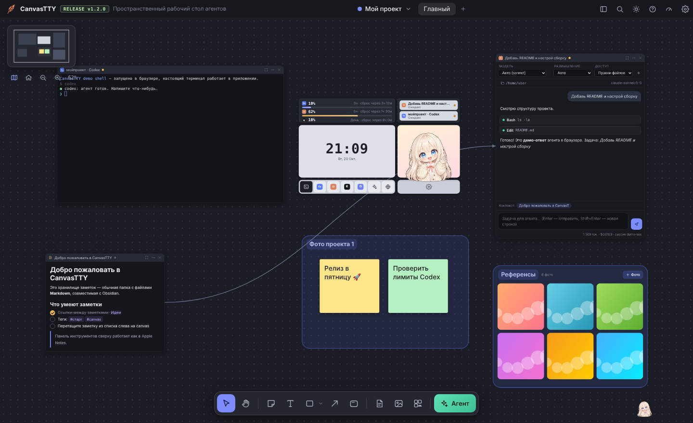
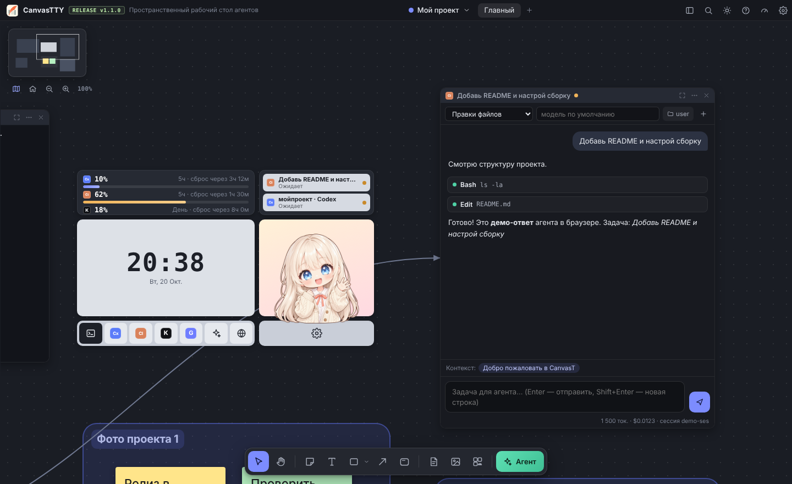
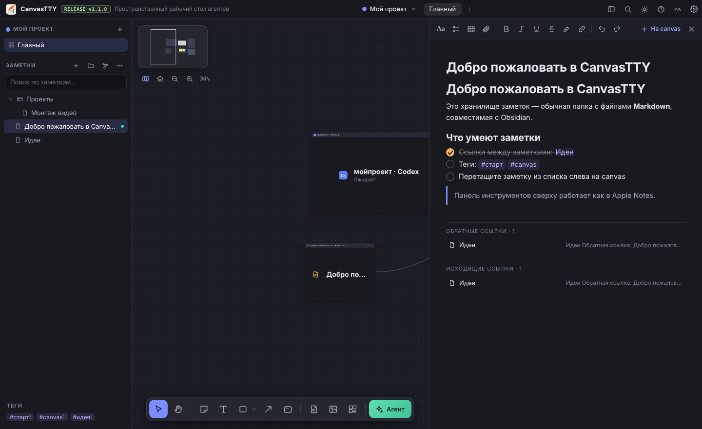
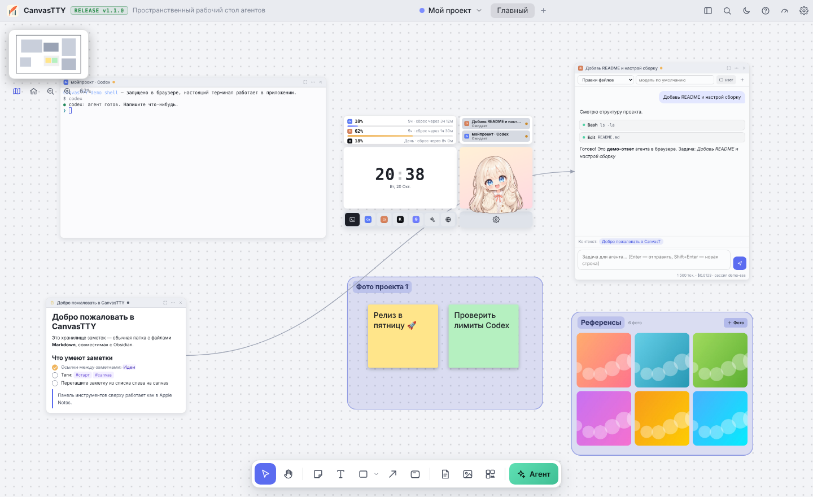
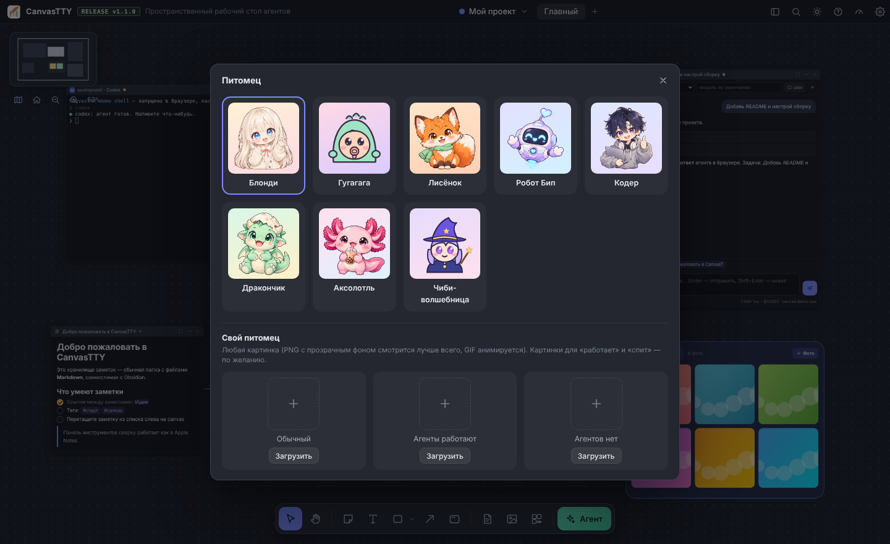

<div align="center">


# CanvasTTY

**Пространственный рабочий стол для AI-агентов**

Бесконечный canvas, на котором рядом живут Codex, Claude Code и другие агенты, чаты с нейросетями, заметки в стиле Obsidian, стикеры, области и галереи фото.

[](https://github.com/SashaVasyanov/CanvasTTY/actions/workflows/build.yml)
[](LICENSE)


*A spatial desktop for AI coding agents: terminals and chat windows for Codex / Claude Code, API chats and Obsidian-style notes on one infinite canvas.*

</div>



## Возможности

**Агенты и нейросети**
- **Окно чата агента** — Claude Code и Codex в виде обычного чата, как в их приложениях. Работают по вашей подписке через установленный CLI, без API-ключа. В ленте видны команды и правки файлов, можно выбрать модель, уровень размышления, режим доступа и рабочую папку, а строка состояния всегда показывает, где и какой моделью работает агент. Сессия продолжается между сообщениями, а **история чатов** слева показывает прошлые разговоры и сессии Claude Code / Codex, в том числе запущенные в терминале.
- **Агенты в терминале** — Codex, Claude Code, Kimi, Gemini CLI или любой свой CLI в настоящем терминале (xterm.js + ConPTY) прямо на canvas.
- **Чаты по API** — Claude (Anthropic), OpenAI, Kimi (Moonshot), OpenRouter, DeepSeek, Gemini, Ollama и любой OpenAI-совместимый сервер, со стримингом ответов.
- **Контекст стрелками** — соедините заметку, стикер или терминал с чатом, и их содержимое уйдёт нейросети.
- **Лимиты** — 5-часовые и недельные лимиты Codex и Claude Code, балансы API.
- **Пульт агентов** — статусы всех агентов, лимиты, часы в стиле iPhone StandBy с датой, кнопки запуска и питомец.

**Canvas**
- Выделение рамкой, перемещение, resize, умные направляющие, выравнивание и распределение, слои, закрепление, undo/redo, копирование.
- Стикеры, текст, фигуры, стрелки-связи, **области с названиями, которые работают как группы**, **галереи фото**, картинки, веб-страницы.
- Миникарта (скрывается), компактные карточки при отдалении, несколько canvas на проект.
- Счётчик FPS и встроенный тест плавности.

**Заметки как в Obsidian**
- Обычная папка с `.md` файлами: можно открыть существующее хранилище Obsidian.
- `[[Вики-ссылки]]` с автодополнением, обратные ссылки, теги, полнотекстовый поиск, граф связей.
- Редактор с панелью как в Apple Notes: стили, чек-листы, таблицы, картинки, Markdown-сокращения.
- Заметки выводятся на canvas по одной, со связями или целым графом.

**Оформление**
- Тёмная, светлая и системная тема, питомцы на выбор или свой из картинки или GIF.

<table>
<tr>
<td></td>
<td></td>
</tr>
<tr>
<td align="center">Окно чата Claude Code и пульт агентов</td>
<td align="center">Заметки, ссылки и теги</td>
</tr>
<tr>
<td></td>
<td></td>
</tr>
<tr>
<td align="center">Светлая тема</td>
<td align="center">Выбор питомца</td>
</tr>
</table>

## Установка

### Готовая сборка
Скачайте последнюю версию на странице [**Releases**](https://github.com/SashaVasyanov/CanvasTTY/releases):
- **Windows** — `CanvasTTY-Setup-x.y.z.exe` (установщик) или `CanvasTTY-Portable-x.y.z.exe` (без установки);
- **macOS** — `.dmg`;
- **Linux** — `.AppImage`.

Сборки без цифровой подписи, поэтому Windows SmartScreen или macOS Gatekeeper при первом запуске спросят подтверждение. Свежую сборку любого коммита можно скачать во вкладке [Actions](https://github.com/SashaVasyanov/CanvasTTY/actions): откройте нужный запуск, раздел «Artifacts».

### Из исходников
Нужен [Node.js](https://nodejs.org) 20 или новее.

```bash
git clone https://github.com/SashaVasyanov/CanvasTTY.git
cd CanvasTTY
npm install
npm start
```

### Агенты (по желанию)
```bash
npm i -g @anthropic-ai/claude-code   # Claude Code
npm i -g @openai/codex               # Codex
npm i -g @google/gemini-cli          # Gemini CLI
uv tool install kimi-cli             # Kimi
```
После установки один раз войдите в агента: откройте его в CanvasTTY в режиме «Терминал» (у Claude Code команда `/login`). API-ключи для чатов задаются в **Настройки → API-провайдеры**.

## Документация

Полная инструкция — [**docs/GUIDE.md**](docs/GUIDE.md). Она же открывается в приложении по кнопке «?» или F1.

Основные горячие клавиши: `V`/`H` — выделение/рука, `S` `T` `R` `F` `G` `A` — стикер, текст, фигура, область, галерея, стрелка, `M` — миникарта, `Shift+1` — показать всё, `Ctrl+P` — палитра команд, `Ctrl+O` — открыть заметку.

## Разработка

| Команда | Что делает |
| --- | --- |
| `npm start` | запустить приложение |
| `npm run dev` | запустить с DevTools |
| `npm run web` | открыть интерфейс в браузере (http://localhost:5577) с демо-данными: удобно верстать без Electron |
| `npm run check` | проверка синтаксиса всех JS-файлов |
| `npm run dist` | собрать установщик для текущей ОС в `release/` |
| `npm run dist:win` / `dist:mac` / `dist:linux` | собрать под конкретную ОС |

**Релиз:** поставьте тег `vX.Y.Z` и отправьте его (`git tag v1.1.0 && git push --tags`). GitHub Actions соберёт Windows, macOS и Linux и прикрепит файлы к релизу.

### Как это устроено
- **Без нативных модулей.** Терминал на Windows работает через крошечный C#-мост к ConPTY (`main/pty/ptybridge.cs`), который при первом запуске компилируется встроенным в Windows `csc.exe`. На macOS и Linux используется Python-модуль `pty`. Поэтому сборка не требует node-gyp и Visual Studio.
- **Окна чата агентов** запускают CLI в неинтерактивном режиме: `claude -p --output-format stream-json` и `codex exec --json`, читают поток событий построчно, а промпт передают через stdin.
- **Интерфейс** — чистый JavaScript (ES-модули) без фреймворков и сборщика. Canvas — это DOM с CSS-трансформацией: окна вне экрана не рисуются, во время движения работает только композитинг.
- **Данные** хранятся локально: проекты и canvas в папке данных приложения (`%APPDATA%\CanvasTTY` на Windows), заметки — в выбранной папке хранилища.

### Структура
```
main/                 главный процесс Electron
  main.js             окно, хранилище, IPC
  pty.js, pty/        терминалы (мост ConPTY / python pty)
  agentchat.js        окна чата Claude Code и Codex
  chat.js             API-чаты (OpenAI-совместимые + Anthropic)
  limits.js           лимиты Codex / Claude Code / API
  vault.js            хранилище заметок (.md)
renderer/             интерфейс
  js/canvas.js        движок canvas
  js/nodes.js         объекты: терминал, чаты, заметка, стикер, область, галерея…
  js/hub.js           пульт агентов и питомцы
  js/editor.js, md.js редактор заметок, Markdown ⇄ HTML
  js/notes.js         боковая панель, граф, редактор
  js/app.js           оболочка, меню, настройки
  vendor/             xterm.js (с патчем), marked
scripts/              проверка, сборка xterm, ярлык для Windows
docs/                 инструкция и скриншоты
```

## Благодарности
- [xterm.js](https://github.com/xtermjs/xterm.js) (MIT) — терминал, собран с патчем для масштабирования, см. [scripts/xterm](scripts/xterm/README.md).
- [marked](https://github.com/markedjs/marked) (MIT) — Markdown.
- [Nunito](https://github.com/googlefonts/nunito) (SIL OFL 1.1) — шрифт часов, подмножество в `renderer/assets/fonts`.
- [Electron](https://www.electronjs.org).
- Питомцы Блонди, Лисёнок, Робот Бип, Кодер, Дракончик и Аксолотль сгенерированы gpt-image.

## Лицензия
[MIT](LICENSE) © 2026 SashaVasyanov
